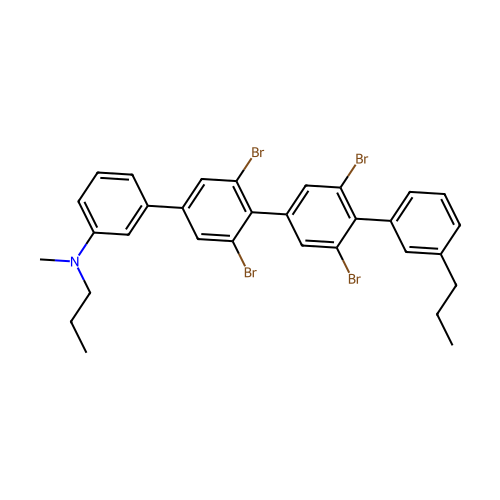
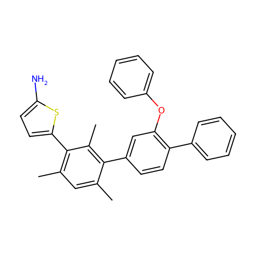
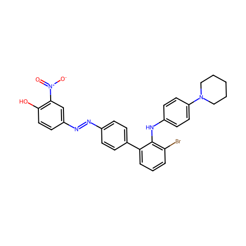

# Polymer Property Prediction Using Multi-Expert Machine Learning, MoE and RidgeStack
## 1. Project Overview

This project focuses on developing a computational framework for polymer representation, molecular feature generation and machine learning-based prediction of polymer properties.

The work includes converting polymer SMILES representations into 2D molecular structure images using RDKit and generating multiple molecular feature representations.

Three polymer properties are investigated:

- Heat Capacity (Cp)

- Atomization Energy (Eat)

- Elongation at Break (epsb)

Four independent XGBoost regression models are trained using different molecular representations. Their predictions are combined using two ensemble approaches:

**MoE (ExtraTrees):** An ExtraTrees-based nonlinear stacking approach that learns to combine predictions from individual experts.

**RidgeStack:** A regularized linear stacking approach that combines predictions from individual experts.

The project also investigates disagreement among individual experts to understand its relationship with prediction errors.

## 2. Project Objectives

The main objectives are:

- **SMILES-to-Image Conversion:** Generate 2D molecular structure images from polymer SMILES using RDKit.

- **Feature Generation:** Generate molecular fingerprints, molecular descriptors, graph-based features and functional group representations.

- **Expert Model Development:** Train separate XGBoost regression models using different feature representations.

- **Ensemble Development:** Combine expert predictions using ExtraTrees-based stacking and RidgeStack.

- **Performance Evaluation:** Compare models using R², MAE and RMSE.

- **Uncertainty Analysis:** Investigate prediction disagreement and its relationship with absolute prediction errors.

- **Literature-Based Analysis:** Study selected polymers using published material-property data to interpret the predicted structure–property relationships.

- **Reproducibility:** Save trained models, predictions, evaluation metrics, generated images and experimental outputs.


## 3. Molecular Feature Representations

Each polymer is represented using four different feature sets. Each feature representation captures different structural or chemical information.

**3.1 Molecular Fingerprints**

Fingerprints encode the presence of molecular substructures as a numerical vector, commonly containing binary values.

They capture local molecular patterns and structural environments.

**3.2 Molecular Descriptors**

Molecular descriptors are numerical quantities that describe molecular characteristics.

Examples include molecular weight, atom counts, molecular composition and other physicochemical or structural characteristics, depending on the descriptors calculated.

**3.3 Graph Features**

Graph-based representations describe the connectivity and topology of molecular structures.

They capture information about how atoms and bonds are connected. In this implementation, graph information is supplied as precomputed numerical features.

**3.4 Functional Group Features**

Functional group features represent the chemical groups present in a polymer.

They provide information about important chemical environments that can influence polymer properties.

## 4. Model Architecture

The proposed framework consists of four independent expert models followed by two ensemble approaches.

**4.1 Individual Expert Models**

Four independent XGBoost regression models are trained:
|Expert | Input Representation|
|-------|--------------------- |
|Fingerprint | Molecular fingerprints|
|Descriptor | Molecular descriptors
|Graph | Graph features|
|Functional group | Functional group features|

Each expert independently predicts the target polymer property.

This allows us to evaluate how effectively each molecular representation captures information relevant to the target property.

**4.2 MoE**

The MoE approach combines predictions from the four individual experts.

Instead of directly combining the original molecular features, the ensemble uses the predictions generated by the experts as its input.

Out-of-fold predictions are generated using K-fold cross-validation to construct the training data for the ensemble model.

The resulting prediction matrix contains four columns, corresponding to the four expert predictions.

An ExtraTrees regression model is then trained on this prediction matrix to learn a nonlinear relationship between expert predictions and the actual target values.

_Important implementation note:_ In the current implementation, the component called MoE uses an ExtraTrees-based nonlinear stacking model. It does not use a conventional neural gating network with explicit expert weights.

**4.3 RidgeStack**

RidgeStack combines the predictions of the four experts using Ridge regression.

It learns a regularized linear combination of expert predictions.

The regularization parameter is selected using cross-validation through RidgeCV.

This approach helps control the influence of correlated expert predictions and reduces the risk of overfitting the stacking model.

## 5. Methodology

The overall workflow consists of the following stages:

1. **Dataset preparation:** Load polymer data and identify valid target values.

2. **Feature loading:** Load the precomputed fingerprint, descriptor, graph and functional group feature datasets.

3. **Data preprocessing:** Handle missing values and prepare the feature matrices.

4. **Train-test splitting:** Divide the valid dataset into training and testing subsets.

5. **Expert training:** Train four independent XGBoost regression models.

6. **Expert evaluation:** Evaluate individual experts using the held-out test dataset.

7. **Out-of-fold prediction generation:** Generate cross-validated predictions for training samples.

8. **Ensemble training:** Train the ExtraTrees-based nonlinear stacking model and RidgeStack using the 
out-of-fold predictions.

9. **Final evaluation:** Compare the ensemble predictions against the individual expert predictions on the held-out test set.

### Data Splitting and Cross-Validation

The implementation uses an 80:20 training-testing split with random seed 42.

Three-fold cross-validation is used to generate out-of-fold predictions for training the stacking models.

The test set is kept separate from the stacking-model training process.

## 6. Model Evaluation Metrics

The models are evaluated using three standard regression metrics.

- **R² (Coefficient of Determination):** Measures how much of the variation in the target values is explained by the model. Higher values indicate better performance.

- **RMSE (Root Mean Squared Error):** Measures prediction error while penalizing larger errors more strongly. Lower values indicate better performance.

- **MAE (Mean Absolute Error):** Measures the average absolute difference between actual and predicted values. Lower values indicate better performance.

The performance of individual experts, MoE and RidgeStack is compared separately for each target property.

## 7. Results and Performance Comparison

The performance of four individual XGBoost expert models and two ensemble approaches was evaluated across the supplied polymer property prediction experiments.

The individual experts were trained using four different molecular feature representations:

- Molecular fingerprints

- Molecular descriptors

- Graph-based features

- Functional group features

Their predictions were combined using an ExtraTrees-based nonlinear stacking approach and RidgeStack.

**7.1 Individual Experts vs Ensemble Models**

The following table presents the R² scores obtained on the respective test sets.

| Property|Fingerprints|Descriptors|Graph|Functional Groups|MoE (ExtraTrees)|RidgeStack
|---------|------------|-----------|-----|-----------------|----------------|----------|
|Cp|0.8676|0.6515|0.3986|0.3914|0.8801|0.8788|
|Eat|0.8830|0.7006|0.4262|0.4294|0.8930|0.8917|
|epsb|0.7285|0.5691|0.4738|0.2066|0.7548|0.7503|

**7.2 Overall Performance Observations**

- Fingerprint-based XGBoost achieved the highest predictive performance among the individual expert models across all six reported experiments.

- Molecular descriptors generally performed better than graph and functional group representations.

- The ExtraTrees-based ensemble achieved the highest R² across all reported experiments.

- RidgeStack also consistently improved upon the strongest individual expert.

- The performance improvement from ensemble learning was relatively modest, indicating that the fingerprint expert already captures substantial predictive information.

The largest improvement over the fingerprint expert was observed for EPSB.

**7.3 Ensemble Model Performance**

The ensemble models were further evaluated using R², RMSE and MAE.

|Property|MoE R²|MoE RMSE|MoE MAE|RidgeStack R²|RidgeStack RMSE|RidgeStack MAE|
|--------|-----|---------|-------|------------|---------------|--------------|
|Cp|0.8801|0.03889|0.02895|0.8788|0.03912|0.02922|
|Eat|0.8930|0.04763|0.03547|0.8917|0.04792|0.03578|
|epsb|0.7548|6.31052|3.36704|0.7503|6.36822|3.41937|

The ExtraTrees-based ensemble achieved slightly better results than RidgeStack across all reported properties, with higher R² and lower RMSE and MAE.

_Note:_ RMSE and MAE values are expressed in the respective target property scales and should not be directly compared across properties.

### Download Complete Results and Experimental Data

Due to the large size of the generated files and experimental artifacts, the complete results are hosted on Google Drive rather than being stored directly in this GitHub repository.

**[Access the Complete Results and Data on Google Drive](https://drive.google.com/drive/folders/1yrxojvVKmGIhqRDDGJUMhrJaLkpncWvx?usp=drive_link)**

The Google Drive repository contains the following:

**1. Trained Models and Evaluation Results**

For each target property (Cp, Eat, epsb), the corresponding results folder contains:

- **Models:** Trained individual expert models and ensemble models.
- **Predictions:** Test-set predictions from individual experts and combined models.
- **OOF Predictions:** Out-of-fold predictions generated during stacking and ensemble training.
- **Splits:** Training and testing indices and source-row information used to maintain data alignment.
- **Metrics:** Individual expert evaluation metrics and overall performance comparisons between experts, MoE and RidgeStack.
- **Preprocessing Artifacts:** Saved imputers and other preprocessing files required for model inference.
- **Run Summary:** JSON files containing information about the training and experimental run.

**2. SMILES-to-Image Conversion Results**

Contains the generated polymer structure images obtained from the original polymer SMILES representations.

**3. Generated Polymer Features**

Contains the molecular feature representations generated from polymer structures, including:

- Molecular fingerprints
- Molecular descriptors
- Graph-based features
- Functional group features

These feature representations are used as inputs to train the individual expert models.

**4. Additional Experimental Outputs**

The Drive folder also contains intermediate and final outputs generated during model training, prediction, evaluation, and analysis.

_Note:_ The GitHub repository provides the source code, notebooks, and project documentation. Google Drive hosts the larger datasets, trained model artifacts, generated images, feature files, and experimental results to facilitate access and reproducibility.

## 8. Comparison with Published State-of-the-Art Models

To evaluate the performance of the developed models in a broader research context, their results were compared with published machine-learning studies on polymer property prediction.

|Property|Published study|Reported performance|
|--------|---------------|--------------------|
|Cp|Ishikiriyama (2025)|R² > 0.98|
|Eat|Kuenneth et al. (2023), polyBERT|Property-specific R² reported in supplementary results|
|epsb|Martins et al. (2014)|R² = 0.88, MAE = 1.89|

The published heat-capacity model used the ATHAS database and predicted temperature-dependent heat capacity using molecular fingerprints. The elongation-at-break study used a neural network trained on a dataset of 77 amorphous polymers.

These results provide useful external reference points. However, the studies differ in dataset size, polymer representation, target-property definitions and validation strategies. Therefore, their reported metrics should not be interpreted as direct head-to-head comparisons with the present models.

The current ExtraTrees-based ensemble achieved R² values of 0.8801 for Cp, 0.8930 for Eat and 0.7548 for epsb. These results demonstrate the performance of the developed framework on its selected dataset and evaluation protocol.

A fair comparison with published models would require evaluating all models on the same dataset, with identical train-test splits, target transformations and evaluation metrics.

### SMILES-to-Image Conversion: Demo

Polymer SMILES representations were converted into 2D molecular structure images using RDKit. This step provides a visual representation of the polymer repeat units and helps inspect the generated molecular structures.

**Example Generated Polymer Structures**

The following examples demonstrate the SMILES-to-image conversion pipeline.

| Example | Generated structure |
|---|---|
| Polymer 1 |  |
| Polymer 2 |  |
| Polymer 3 |  |

*Note: Replace these example filenames with actual generated image filenames from the project.*

The complete set of generated polymer images is stored separately because of its large size. A small representative sample is included in this repository for demonstration.

## 9. Prediction Disagreement and Uncertainty Analysis

The disagreement between the four individual experts can be used as an indicator of prediction uncertainty.
For a given polymer, let the four expert predictions be:

$$
(P_{\mathrm{FP}}, P_{\mathrm{Desc}}, P_{\mathrm{Graph}}, P_{\mathrm{FG}}).
$$

**9.1 Calculation of Expert Disagreement**

The disagreement score can be calculated as the standard deviation of these predictions:

$$
D_i = \text{Std}\left(
P_{\mathrm{FP},i},
P_{\mathrm{Desc},i},
P_{\mathrm{Graph},i},
P_{\mathrm{FG},i}
\right)
$$

A higher disagreement indicates that the experts provide more different predictions for that polymer.

This disagreement can be compared with the absolute prediction error to investigate whether it is associated with model reliability.

**9.2 Absolute Prediction Error**

The absolute prediction errors were calculated separately for the two ensemble models.

$$
E_{\mathrm{MoE},i} =
|y_i-\hat{y}_{\mathrm{MoE},i}|
$$

$$
E_{\mathrm{RidgeStack},i} =
|y_i-\hat{y}_{\mathrm{RidgeStack},i}|
$$

**9.3 Pearson Correlation Analysis**

Pearson correlation was used to investigate the linear relationship between expert disagreement and absolute prediction error.

$$
r = \frac{\text{Cov}(D,E)}{\sigma_D \sigma_E}
$$

The following results were obtained:

|Property|MoE Pearson r|RidgeStack Pearson r|
|--------|-------------|---------------------|
|Cp|0.1751|0.1917|
|Eat|0.1654|0.1791|
|epsb|0.5242|0.5347|

**9.4 Interpretation of Correlation Results**

- epsb shows the strongest positive correlation, indicating that higher expert disagreement tends to be associated with larger prediction errors.

- Cp and Eat show relatively weak positive correlations.

- RidgeStack consistently shows slightly higher disagreement-error correlations than the ExtraTrees-based ensemble.

- The results indicate that expert disagreement alone cannot fully explain prediction errors.

An important observation is that model predictive performance and the usefulness of disagreement as an uncertainty indicator are different aspects of evaluation.

For example, Eat achieves an R² of approximately 0.893 but has a weak disagreement-error correlation. In contrast, epsb has a lower R² of approximately 0.755 but shows a stronger positive correlation.

**9.5 Distribution of Expert Disagreement**

The following statistics summarize the disagreement distribution across the test samples.

|Property|Mean Di|Median Di|95th Percentile Di|
|--------|-------|---------|------------------|
|Cp|0.040242|0.033334|0.094716|
|Eat|0.051785|0.042706|0.121496|
|epsb|3.741236|2.738976|9.860247|

These statistics describe the distribution of expert disagreement within each property. Since the target properties have different numerical scales and units, their disagreement magnitudes should not be directly compared.

**9.6 Limitations of the Uncertainty Analysis**

Expert disagreement is investigated as a proxy for prediction uncertainty rather than a calibrated uncertainty estimate.

Pearson correlation measures linear association and does not establish causation. A weak correlation does not necessarily exclude nonlinear relationships between disagreement and prediction error.

Further investigation using alternative uncertainty quantification techniques and calibration methods may help improve the reliability of prediction uncertainty estimates.

_Note:_ Expert disagreement is a proxy for uncertainty, not a calibrated prediction interval or a guarantee of prediction error.

## 10. Repository Structure

The repository contains property-specific model implementations and their corresponding evaluation results.

An example organization is:

```text
Polymer-Property-Prediction/
│
├── Demo/
│   └── SMILES_to_Images/
│       ├── polymer_000001.png
│       ├── polymer_000002.png
│       └── polymer_000003.png
│
├── Property Codes/
│   ├── Cp.ipynb
|   ├── Eat.ipynb
│   └── epsb.ipynb
│
├── Results/
│   ├── Cp
|   ├── Eat
|   └── epsb
│
├── Feature Extraction Code
│
├── Simile to Image Generation
|
└── README.md
```

## 11. Requirements

The implementation uses Python and common machine learning and scientific computing libraries.
The main dependencies include:

- Python

- NumPy

- Pandas

- Scikit-learn

- XGBoost

The exact package versions should be documented to support reproducibility.

## 12. Execution Instructions

- Clone or download the repository.
  
- Open the relevant property-specific notebook in Google Colab or Jupyter Notebook.

- Provide access to the required polymer dataset and precomputed feature files.

- Update the input and output paths according to your environment.

- Execute the notebook cells in sequence.

- Review the saved model predictions and evaluation metrics.
The feature-generation process and required input files should be documented separately if they are not included in this repository.

## 13. Limitations and Future Work

Potential directions for further development include:

- Complete the image-to-SMILES reconstruction pipeline using image-based molecular recognition models such as MolScribe.
  
- Compare reconstructed SMILES representations with their original polymer structures.
  
- Evaluate reconstruction accuracy and identify errors in terminal groups, atoms, and molecular connectivity.
  
- Investigate the potential integration of image-based molecular recognition with the polymer property prediction workflow.
  
- Further improve model uncertainty estimation and prediction reliability.

- Exploring additional molecular representations.

- Investigating more advanced expert-combination architectures with explicit gating networks.

- Improving uncertainty estimation through calibrated prediction intervals.

- Evaluating generalization on structurally distinct or externally sourced polymer datasets.

- Investigating the relationship between expert disagreement and prediction errors.

- Developing a unified framework for predicting multiple polymer properties.

## 14. Conclusion

This project investigates a multi-representation machine-learning framework for predicting three polymer properties: heat capacity (Cp), atomization energy (Eat) and elongation at break (epsb).

Four independent XGBoost experts are trained using molecular fingerprints, molecular descriptors, graph features and functional group representations. Their predictions are combined using an ExtraTrees-based nonlinear stacking model and RidgeStack.

The ExtraTrees-based ensemble achieves the highest R² across all three properties. The disagreement analysis further shows that its relationship with prediction error varies by property, with epsb exhibiting the strongest positive correlation.

Finally, literature-based polymer case studies provide a scientific basis for interpreting the predicted structure–property relationships and identifying possible directions for further investigation.
